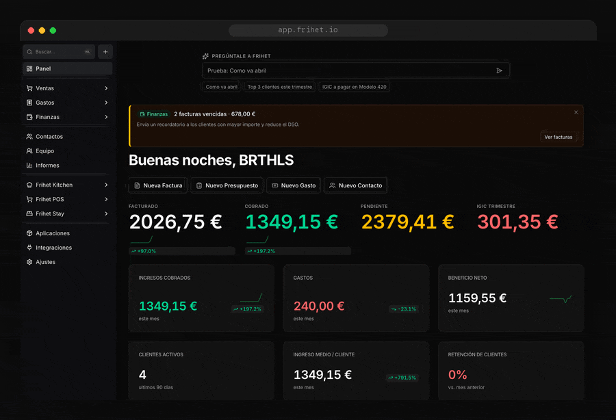

<p align="center">
  <picture>
    <source media="(prefers-color-scheme: dark)" srcset="./assets/banner.svg">
    <source media="(prefers-color-scheme: light)" srcset="./assets/banner-light.svg">
    
  </picture>
</p>

<p align="center">
  <strong>AI-native MCP server for business management.</strong><br/>
  <em>Servidor MCP nativo con IA para gestión empresarial.</em>
</p>

<p align="center">
  <sub>Works with <strong>Claude</strong> · <strong>ChatGPT</strong> · <strong>Cursor</strong> · <strong>Windsurf</strong> · <strong>Cline</strong> · <strong>Antigravity</strong> · <strong>Codex</strong> · <strong>Copilot</strong> · <strong>Gemini CLI</strong> — and any MCP-compatible client.</sub>
</p>

<p align="center">
  <a href="https://www.npmjs.com/package/@frihet/mcp-server"></a>
  <a href="https://www.npmjs.com/package/@frihet/mcp-server"></a>
  <a href="https://registry.modelcontextprotocol.io/?q=io.frihet"></a>
  
  <a href="https://github.com/Frihet-io/frihet-mcp/blob/main/LICENSE"></a>
</p>

<p align="center">
  
</p>

---

## What is this

An MCP server that connects your AI assistant to [Frihet](https://frihet.io/?utm_source=github_readme&utm_medium=mcp_readme&utm_campaign=mcp_landgrab), the AI-native ERP for businesses of any size. Ask for invoices, expenses, clients, quotes, banking and tax figures in plain language, from the tools you already use.

```
You:     "Create an invoice for TechStart SL, 40 hours of consulting at 75 EUR/hour, due March 1st"
Claude:  Done. Invoice INV-2026-089 created. Total: 3,000.00 EUR + 21% IVA = 3,630.00 EUR.
```

158 canonical operations. Five fiscal aliases. Ten prompts. The local package serves 11 resources; the hosted Worker deliberately serves the 7 static resources, while API-backed workspace resources remain local-profile only.

---

## Quick start

**Remote, one step.** Add `https://mcp.frihet.io/mcp` as a remote MCP server in any client that supports OAuth. You sign in with your browser; there is nothing to install and no key to copy.

**Local, with your API key** (create one in [app.frihet.io](https://app.frihet.io) under Settings > API):

```bash
claude mcp add frihet -s user -e FRIHET_API_KEY=fri_your_key_here -- npx -y @frihet/mcp-server
```

**No account yet?** Try demo mode. It answers from example data, persists nothing and makes no network calls:

```bash
FRIHET_DEMO=1 npx -y @frihet/mcp-server
```

Local installs need Node 22.23.4+, 24.22.1+ or 26.12.1+. Other clients are covered under [Client setup](#client-setup).

---

## Distribution

### Where to get it

| Channel | Status | Entry point |
|---|---|---|
| npm | Published | [`@frihet/mcp-server`](https://www.npmjs.com/package/@frihet/mcp-server) · `npx -y @frihet/mcp-server` |
| Remote MCP | Live, OAuth or API key | `https://mcp.frihet.io/mcp` (running version at [`/health`](https://mcp.frihet.io/health)) |
| ChatGPT app | Live | [Frihet in ChatGPT](https://chatgpt.com/plugins/plugin_asdk_app_6ac6b51bd7648191a0696bd1e725bfe6) |
| Raycast | Coming to the Raycast Store | [Submission](https://github.com/raycast/extensions/pull/33017) |
| Official MCP Registry | Listed | [`io.frihet/erp`](https://registry.modelcontextprotocol.io/?q=io.frihet) |
| GitHub MCP Registry | Listed | [Frihet ERP](https://github.com/mcp/io.frihet/erp) |

Also listed on [Glama](https://glama.ai/mcp/servers/Frihet-io/frihet-mcp), [Cursor Directory](https://cursor.directory/plugins/mcp-frihet), [mcp.so](https://mcp.so/servers/frihet-mcp), [mcpservers.org](https://mcpservers.org/servers/frihet-io/frihet-mcp) and the [ToolSDK registry](https://github.com/toolsdk-ai/toolsdk-mcp-registry/blob/main/packages/finance-fintech/frihet-mcp.json).

> **Surface truth:** the catalogue contains 158 canonical operations. The local full profile serves 163 tool names, 11 resources, and 10 prompts (158 canonical operations plus 5 fiscal aliases). The hosted grouped profile serves 166 tool names, 7 resources, and 10 prompts (the same names plus 3 discovery tools, with API-backed resources kept local-only). The separately reviewed OpenAI profile serves 33 tool names, 0 resources, and 0 prompts. These counts describe the current source release; the hosted server reports the version it is running at `/health`. Catalogue membership is not a promise that a backing API is enabled for every workspace.

---

## What you can do

Real prompts, grouped by area.

| Area | Try asking |
|------|------------|
| Invoicing | "Show me all unpaid invoices" · "Create an invoice for Acme SL with 10h of consulting at 95/hour" · "Mark invoice abc123 as paid" |
| Expenses | "Log a 59.99 EUR expense for Adobe Creative Cloud, category: software, tax-deductible" · "What did I spend on travel last quarter?" |
| Clients and CRM | "Add a new client: TechStart SL, NIF B12345678" · "Log a call with TechStart: discussed Q2 proposal" · "Show all activities for Acme SL" |
| Quotes | "Create a quote for Design Studio: logo design (2000 EUR) + brand guidelines (3500 EUR)" |
| Tax and reporting | "Prepare my quarterly tax summary" · "Give me this month's profit and loss" |
| Webhooks | "Set up a webhook to notify https://my-app.com/hook when invoices are paid" |

Beyond these, the catalogue covers banking, e-invoicing, time tracking, recurring invoices, HR and payroll, POS and more. See the [full catalogue](#full-catalogue).

---

## Client setup

### Claude Code

```bash
claude mcp add frihet -s user -e FRIHET_API_KEY=fri_your_key_here -- npx -y @frihet/mcp-server
claude mcp list          # verify: frihet ✓ Connected
```

Or use the hosted server: `claude mcp add --transport http frihet https://mcp.frihet.io/mcp`.

### Codex CLI

```bash
codex mcp add frihet --env FRIHET_API_KEY=fri_your_key_here -- npx -y @frihet/mcp-server
```

Codex reads TOML, not JSON. Pasting a JSON `mcpServers` block into `~/.codex/config.toml` is a parse error that breaks the whole file, so use the command above.

### Claude Desktop, Cursor, Windsurf, Cline

```json
{
  "mcpServers": {
    "frihet": {
      "command": "npx",
      "args": ["-y", "@frihet/mcp-server"],
      "env": {
        "FRIHET_API_KEY": "fri_your_key_here"
      }
    }
  }
}
```

| Client | Config file |
|------|------------|
| Claude Desktop | `~/Library/Application Support/Claude/claude_desktop_config.json` |
| Cursor | `.cursor/mcp.json` or `~/.cursor/mcp.json` |
| Windsurf | `~/.windsurf/mcp.json` |
| Cline | VS Code settings or `.cline/mcp.json` |

### Remote server with an API key

```json
{
  "mcpServers": {
    "frihet": {
      "type": "streamable-http",
      "url": "https://mcp.frihet.io/mcp",
      "headers": {
        "Authorization": "Bearer fri_your_key_here"
      }
    }
  }
}
```

Clients that support OAuth 2.1 with PKCE can connect to the same URL and sign in through the browser instead.

### ChatGPT

Open [Frihet in ChatGPT](https://chatgpt.com/plugins/plugin_asdk_app_6ac6b51bd7648191a0696bd1e725bfe6) and connect your account.

### Skill for coding agents

```bash
npx skills add Frihet-io/frihet-mcp
```

Installs the Frihet skill for Claude Code, Cursor, Codex, Windsurf, Gemini CLI and others. It routes requests to the MCP tools and asks for confirmation before writes. Tax figures come from your Frihet data, not from the skill. [Skill docs](https://docs.frihet.io/desarrolladores/skill-claude-code).

### Get your API key

1. Log into [app.frihet.io](https://app.frihet.io)
2. Go to **Settings > API**
3. Click **Create API key**
4. Copy the key (starts with `fri_`). It is only shown once.

---

## For AI agents

If you are an agent reading this repository, the contract is machine-readable and generated from the running server.

| What | Where |
|------|-------|
| Onboarding contract: quickstart per client, auth, safe workflow, human-authority tool lists, error recovery | [`docs/agent-onboarding.json`](./docs/agent-onboarding.json), also shipped in the npm package |
| Per-tool capability truth: `callability`, `writesFrihet`, `externalInteraction`, `externalSideEffects` | `_meta["io.frihet/capability"]` on every entry of `tools/list` |
| How to behave once connected | the `instructions` string returned by `initialize` |

1. **Orient before acting.** `get_business_context` and the `frihet://tax/rates` resource decide the correct fiscal treatment. Do not recall a tax rate from memory.
2. **Draft, show, stop.** `create_invoice`, `create_quote` and `create_credit_note` default to `status=draft`: no fiscal number, no hash, nothing sent to a tax authority.
3. **Human authority is not yours to assume.** Any tool with a non-empty `externalSideEffects` reaches a client's inbox, a webhook, money, or a tax authority. Several also take `confirm=true`; that flag records a human decision.

---

## What to expect

This MCP is a **structured data interface** -- you describe what you want in natural language, and the AI creates, queries, or modifies business records in Frihet. Most of the 158 canonical operations are CRUD operations over the REST API; the rest are read-only summaries and fiscal/e-invoice actions. Alias and discovery names are counted separately.

It does not do OCR, PDF scanning, file upload or image processing. To digitize a paper invoice, extract the data first (a vision model, an OCR service, or manual entry), then ask the assistant to create the record. One API key maps to one Frihet workspace, and you need a Frihet account at [app.frihet.io](https://app.frihet.io).

---

## Full catalogue

<details>
<summary><strong>All 158 canonical operations, resources and prompts</strong></summary>

### Invoices (12)

| Tool | What it does |
|------|-------------|
| `list_invoices` | List invoices with pagination |
| `get_invoice` | Get full invoice details by ID |
| `create_invoice` | Create a new invoice with line items |
| `update_invoice` | Update any invoice field |
| `delete_invoice` | Delete a draft invoice; a sent/paid one is cancelled, not destroyed (`confirm=true` required) |
| `search_invoices` | Find invoices by client name, date, or status |
| `send_invoice` | Email invoice to client (PDF attachment) — reaches a third party, `confirm=true` required |
| `mark_invoice_paid` | Mark an invoice as paid with optional payment date |
| `get_invoice_pdf` | Get bounded invoice PDF bytes as base64 |
| `get_invoice_einvoice` | Get bounded XML or Factur-X PDF bytes for an invoice |
| `create_credit_note` | Create a credit note linked to an existing invoice |
| `apply_late_fee` | Apply a late payment fee to an overdue invoice |

### Expenses (5)

| Tool | What it does |
|------|-------------|
| `list_expenses` | List expenses with pagination |
| `get_expense` | Get expense details |
| `create_expense` | Record a new expense |
| `update_expense` | Modify an expense |
| `delete_expense` | Delete an expense |

### Clients (5)

| Tool | What it does |
|------|-------------|
| `list_clients` | List all clients |
| `get_client` | Get client details |
| `create_client` | Register a new client |
| `update_client` | Update client info |
| `delete_client` | Remove a client |

### CRM: Contacts (3)

| Tool | What it does |
|------|-------------|
| `list_client_contacts` | List all contacts for a client |
| `create_client_contact` | Add a contact person to a client |
| `delete_client_contact` | Remove a contact from a client |

### CRM: Activities (2)

| Tool | What it does |
|------|-------------|
| `list_client_activities` | List CRM activities (calls, emails, meetings, tasks) |
| `log_client_activity` | Log a call, email, meeting, or task against a client |

### CRM: Notes (3)

| Tool | What it does |
|------|-------------|
| `list_client_notes` | List all notes for a client |
| `create_client_note` | Add a free-form note to a client |
| `delete_client_note` | Remove a note from a client |

### Products (5)

| Tool | What it does |
|------|-------------|
| `list_products` | List products and services |
| `get_product` | Get product details |
| `create_product` | Add a product or service |
| `update_product` | Update pricing or details |
| `delete_product` | Remove a product |

### Quotes (6)

| Tool | What it does |
|------|-------------|
| `list_quotes` | List all quotes |
| `get_quote` | Get quote details |
| `create_quote` | Draft a new quote |
| `update_quote` | Modify a quote |
| `delete_quote` | Delete only a clean draft with no delivery, response, attachment, or conversion evidence; refuse protected drafts; cancel non-drafts (`confirm=true` required) |
| `send_quote` | Email quote to client for acceptance |

### Webhooks (6)

| Tool | What it does |
|------|-------------|
| `list_webhooks` | List configured webhooks |
| `get_webhook` | Get webhook details |
| `create_webhook` | Register a new webhook endpoint |
| `update_webhook` | Modify events or URL |
| `delete_webhook` | Remove a webhook |
| `test_webhook` | Send a test payload to a configured webhook endpoint |

### Intelligence (4)

| Tool | What it does |
|------|-------------|
| `get_business_context` | Full snapshot: profile, plan, recent activity, top clients, current month |
| `get_monthly_summary` | Monthly P&L: revenue, expenses, profit, tax liability, top clients by revenue |
| `get_quarterly_taxes` | Quarterly tax prep: Modelo 303/130 fields, collected vs deductible, liability |
| `duplicate_invoice` | Clone an invoice for recurring billing (copies items/client/tax, starts as draft) |

### E-Invoicing (10)

| Tool | What it does |
|------|-------------|
| `send_einvoice` | Dispatch an invoice in 11 formats (XRechnung, Factur-X, FatturaPA, PEPPOL, Facturae, UBL, CII) via email / Chorus Pro / SDI / PEPPOL / download |
| `get_einvoice_status` | Poll an e-invoice dispatch until it succeeds or fails; returns ackId, XML URL and PDF/A-3 URL |
| `validate_einvoice_xml` | Validate raw XML against format schema + schematron rules (KOSIT / Mustang / XSD / Schematron) |
| `export_datev` | Export accounting data as DATEV EXTF (Buchungsstapel / Debitoren / Kreditoren) in CP1252 encoding |
| `einvoice_export` | Export e-invoice data in machine-readable formats (JSON/XML) for archival or integration |
| `face_submit` | Submit invoice to FACe (Spain B2G government e-invoicing platform) |
| `face_status` | Poll submission status from FACe for a submitted invoice |
| `ticketbai_submit` | Submit TicketBAI fiscal record to Basque Country tax authority (Hacienda) |
| `ticketbai_status` | Poll TicketBAI submission status from the Basque tax authority |
| `ksef_submit` | **NOT_DEPLOYED**: submit an invoice to KSeF (Poland). Returns a labeled "unavailable" error until activated |

### Time Tracking (6)

| Tool | What it does |
|------|-------------|
| `list_time_entries` | List time entries with filter by user, project, date range, billable status |
| `get_time_entry` | Get full details of a single time entry by ID |
| `create_time_entry` | Log hours for a project (billable flag, description, date) |
| `update_time_entry` | Update any field on an existing time entry (PATCH semantics) |
| `delete_time_entry` | Soft-delete a time entry (confirm=true required) |
| `get_time_summary` | Aggregate total/billable/non-billable hours for a period, with optional groupBy (user/project/day) |

### Recurring Invoices (8)

| Tool | What it does |
|------|-------------|
| `list_recurring_invoices` | List all recurring invoice templates (filter by active/paused) |
| `get_recurring_invoice` | Get full details of a recurring template by ID |
| `create_recurring_invoice` | Create a new recurring invoice template (daily/weekly/monthly/quarterly/yearly) |
| `update_recurring_invoice` | Update template fields — affects future generated invoices only |
| `pause_recurring_invoice` | Pause an active template — no invoices generated while paused |
| `resume_recurring_invoice` | Resume a paused template — next invoice on next scheduled cycle |
| `delete_recurring_invoice` | Permanently delete a template (confirm=true required) |
| `run_recurring_now` | Generate the next recurring invoice with explicit `confirm=true` in full and grouped modes; workspace settings may trigger fiscal issuance, submission and webhooks |

### Team Management (4)

| Tool | What it does |
|------|-------------|
| `list_team_members` | List active members + pending invites (owner excluded) |
| `invite_team_member` | Invite a new member by email with role (admin/editor/accountant/viewer) |
| `update_team_member_role` | Change an existing member's role (admin/editor/accountant/viewer) |
| `remove_team_member` | Remove a member from the workspace (confirm=true required) |

### Gestoria — Accountants (5)

| Tool | What it does |
|------|-------------|
| `gestoria_message_send` | Send a message in a contextual thread (documentRequest / filingItem / obligation) |
| `gestoria_messages_list` | List messages in a thread, newest first; paginate backwards with `before` |
| `gestoria_template_create` | Create a reusable document request template with variables + due-date offset |
| `gestoria_template_bulk_send` | Bulk send a template to up to 500 client workspaces in one call |
| `gestoria_aging_consolidated` | Cross-client AR aging report (buckets, per-workspace breakdown, top overdue) |

### Audit GL (3)

| Tool | What it does |
|------|-------------|
| `frihet_gl_entry_approve` | Approve a GL journal entry (gestor/admin only, restricted) |
| `frihet_gl_entry_reject` | Reject a GL entry with a mandatory reason (restricted) |
| `frihet_gl_entry_audit_log` | Retrieve full audit trail for a GL entry |

### White-label Portal Domain (3)

| Tool | What it does |
|------|-------------|
| `frihet_portal_domain_add` | Add a custom domain to the client portal (returns DNS CNAME records) |
| `frihet_portal_domain_verify` | Verify DNS propagation for a custom portal domain |
| `frihet_portal_domain_remove` | Remove a custom portal domain (reverts to default Frihet subdomain) |

### Self-onboard & VIES (2)

| Tool | What it does |
|------|-------------|
| `frihet_portal_onboard_link_generate` | Generate a time-limited self-onboard link for a prospective client |
| `frihet_tax_id_vies_lookup` | Validate an EU VAT number (CIF intracomunitario) via VIES |

### IGIC — Canary Islands Indirect Tax (4)

| Tool | What it does |
|------|-------------|
| `frihet_modelo_415_summary` | M415 annual operations >€3,005 (Canarias equivalent of M347) — not deployed, returns `NOT_DEPLOYED` |
| `frihet_modelo_425_summary` | M425 annual IGIC recap for Canary Islands businesses — not deployed, returns `NOT_DEPLOYED` |
| `frihet_modelo_418_summary` | M418 monthly individual IGIC return, régimen especial del grupo de entidades — not deployed, returns `NOT_DEPLOYED` |
| `frihet_aiem_calculate` | AIEM (Arbitrio Importación) calculation for Canarias — not deployed, returns `NOT_DEPLOYED` |

### Impuesto sobre Sociedades — Corporate Tax (2)

| Tool | What it does |
|------|-------------|
| `frihet_modelo_200_summary` | Modelo 200 annual IS return — not deployed, returns `NOT_DEPLOYED` |
| `frihet_modelo_202_summary` | Modelo 202 installment payments (1P/2P/3P) — not deployed, returns `NOT_DEPLOYED` |

### Bank Categorization Rules (2)

| Tool | What it does |
|------|-------------|
| `frihet_bank_rules_list` | List all bank auto-categorization rules (conditions + actions + status) |
| `frihet_bank_rule_create` | Create a new rule to auto-categorize transactions by description, amount, counterparty |

### Deposits (7)

| Tool | What it does |
|------|-------------|
| `list_deposits` | List deposits with pagination |
| `get_deposit` | Get deposit details by ID |
| `create_deposit` | Record a new client deposit |
| `update_deposit` | Update deposit fields |
| `delete_deposit` | Delete a deposit (confirm=true required) |
| `apply_deposit` | Apply a deposit balance against an invoice |
| `refund_deposit` | Record a deposit refund in Frihet bookkeeping with `confirm=true`; optional `amount` records that portion, omission records the remaining refundable balance. Does not transfer money |

### Vendors (5)

| Tool | What it does |
|------|-------------|
| `list_vendors` | List all vendors/suppliers |
| `get_vendor` | Get vendor details |
| `create_vendor` | Add a new vendor |
| `update_vendor` | Update vendor info |
| `delete_vendor` | Remove a vendor |

### Banking (5)

| Tool | What it does |
|------|-------------|
| `list_bank_accounts` | List connected bank accounts |
| `get_bank_account` | Get details for a bank account |
| `list_transactions` | List bank transactions with filters |
| `categorize_transaction` | Assign a category and expense/income type to a transaction |
| `match_transaction_to_invoice` | Link a bank transaction to an existing invoice |

### Fiscal — Spanish Tax Models (7)

| Tool | What it does |
|------|-------------|
| `get_modelo_303_summary` | Quarterly IVA return (Modelo 303) — collected vs deductible, net payable |
| `get_modelo_130_summary` | Quarterly IRPF installment for self-employed (Modelo 130) |
| `get_modelo_390_summary` | Annual IVA summary (Modelo 390) |
| `get_modelo_180_summary` | Annual withholding summary for rentals (Modelo 180) — not deployed, returns `NOT_DEPLOYED` |
| `get_modelo_347_summary` | Annual third-party transactions >€3,005 (Modelo 347) |
| `verifactu_status` | Get VeriFactu submission status for a fiscal record |
| `verifactu_resubmit` | Resubmit a rejected VeriFactu fiscal record |

### Vacation Rentals / Stay (5)

| Tool | What it does |
|------|-------------|
| `list_reservations` | List rental reservations with filters |
| `get_reservation` | Get reservation details |
| `create_reservation` | Create a new reservation |
| `list_properties` | List all rental properties |
| `sync_channel` | Trigger OTA channel sync (Airbnb, Booking.com, etc.) |

### POS — Point of Sale (4)

| Tool | What it does |
|------|-------------|
| `list_terminals` | List registered POS terminals |
| `get_sale` | Get details for a POS sale transaction |
| `list_sales` | List POS sales with pagination |
| `refund_sale` | Issue a refund for a POS sale |

### Kitchen / Restaurant (6)

| Tool | What it does |
|------|-------------|
| `list_kitchen_tickets` | List kitchen order tickets for the live board, filtered by status or station |
| `get_kitchen_ticket` | Get a single kitchen ticket by ID with all items and their individual statuses |
| `update_kitchen_ticket` | Advance a ticket's status (queued → preparing → ready → served) or reassign it to another station |
| `list_kitchen_stations` | List all kitchen stations with id, name, and active status |
| `list_menu_items` | List the kitchen menu catalog with free-text search and active/inactive filter |
| `kitchen_flow_summary` | Slow-station detection: aggregate open tickets per station and flag the bottleneck |

### HR — Human Resources (9)

| Tool | What it does |
|------|-------------|
| `leave_request_create` | Create a leave request (vacation, sick, personal) |
| `leave_approve` | Approve a pending leave request |
| `leave_reject` | Reject a leave request with a reason |
| `leave_cancel` | Cancel an approved or pending leave request |
| `leave_list` | List leave requests with filters (user, status, date range) |
| `attendance_clock_in` | Record clock-in for an employee |
| `attendance_clock_out` | Record clock-out for an employee |
| `overtime_report` | Read daily/weekly overtime, aggregate minutes/hours, and compliance alerts computed over the selected YYYY or YYYY-MM records |
| `anomaly_list` | List attendance anomalies (missing punches, excessive overtime) |

### Payroll (2)

| Tool | What it does |
|------|-------------|
| `payroll_export` | Read normalized payroll-ready employee data; the format value is an echoed destination label, not a generated file |
| `payroll_checklist` | List payable employees with payroll-profile readiness, missing fields, and monthly review state |


### Permissions (2)

| Tool | What it does |
|------|-------------|
| `permissions_matrix` | Get the documented RBAC-model snapshot (not a runtime authorization guarantee) |
| `permissions_me` | Compare RBAC-model fields with actual API-key scopes and known scope denials (non-exhaustive) |

### Period Close (3)

| Tool | What it does |
|------|-------------|
| `period_close_status` | Get the current or selected YYYY fiscal-year range, open/closed state, and nullable closing details |
| `period_close` | Close an accounting period (gestor/admin only, restricted) |
| `period_reopen` | Reopen a closed period with a mandatory reason (restricted) |

All canonical operations (and their aliases) return **structured output** via `outputSchema` -- typed JSON, not raw text. List response shapes follow their API family; not every list endpoint is paginated.

### Capability and side-effect truth

On the full MCP surfaces, every `tools/list` entry includes `_meta["io.frihet/capability"]`:

- `registered` means the name and handler exist in this server build;
- `callability` is `api_dependent` (the handler calls the API; deployment, workspace enablement, and authorization still decide), `runtime_checked` (the handler explicitly distinguishes an absent backend from empty data), `deferred`, `unavailable`, or `local`—never an unconditional “available” claim;
- `writesFrihet`, `externalInteraction`, and `externalSideEffects` distinguish state changes and calls to external entities/providers;
- MCP action annotations remain the standard source for read-only, destructive, idempotent, and open-world hints.

The ChatGPT app uses a separately reviewed profile of 33 business operations, with no discovery meta-tools, prompts or resources. Its 17 reads and 16 writes are deliberately narrow, and every write requires literal `confirm=true`. Do not infer it from the full catalogue.

### Resources

Context the AI can read to make smarter decisions.

The local package serves 11 resources: 7 static references plus 4 API-backed workspace resources. The hosted Worker serves the 7 static resources. The OpenAI-reviewed host serves 0 resources.

**Static** (reference data, no API calls):

| Resource | URI | What it provides |
|----------|-----|-----------------|
| API Schema | `frihet://api/schema` | OpenAPI summary: endpoints, auth, rate limits, pagination, error codes |
| Tax Rates | `frihet://tax/rates` | Tax rates by Spanish fiscal zone: IVA, IGIC, IPSI, EU reverse charge, IRPF |
| Tax Calendar | `frihet://tax/calendar` | Quarterly and annual filing deadlines for the listed Spanish tax models |
| Expense Categories | `frihet://config/expense-categories` | 8 categories with deductibility rules, IVA treatment, amortization |
| Invoice Statuses | `frihet://config/invoice-statuses` | Status flow (draft > sent > paid/overdue > cancelled), transition rules, webhook events |
| Currencies | `frihet://config/currencies` | 40 supported currencies with ISO codes, symbols, decimal places, locale formatting |
| Countries | `frihet://config/countries` | Supported countries with fiscal zones, default tax rates, currencies, invoice prefixes |

**Dynamic** (live data from your account):

| Resource | URI | What it provides |
|----------|-----|-----------------|
| Business Profile | `frihet://business-profile` | Your business info, plan, defaults, recent activity, top clients |
| Monthly Snapshot | `frihet://monthly-snapshot` | Current month P&L, revenue, expenses, tax liability |
| Overdue Invoices | `frihet://overdue-invoices` | All invoices past due date (up to 100) |
| Plan Limits | `frihet://status/plan-limits` | Live plan tier, usage counters, invoices/month, API rate limits |

### Prompts (10)

Pre-built workflows the AI can execute as guided multi-step operations.

| Prompt | What it does | Arguments |
|--------|-------------|-----------|
| `monthly-close` | Close the month: review unpaid invoices, categorize expenses, check tax obligations, generate summary | `month?` (YYYY-MM) |
| `onboard-client` | Set up a new client with correct tax rates by location, optionally create a welcome quote | `clientName`, `country?`, `region?` |
| `quarterly-tax-prep` | Prepare quarterly tax filing: calculate IVA/IGIC, identify deductibles, preview Modelo 303/130/420 | `quarter?`, `fiscalZone?` |
| `overdue-followup` | Find overdue invoices, draft follow-up messages, suggest payment reminders | -- |
| `new-client-invoice` | Create a client + first invoice in one workflow with tax rate lookup | `clientName`, `country?` |
| `expense-report` | Generate expense report grouped by category with deductible totals | `month?` (YYYY-MM) |
| `year-end-close` | Full annual closing: quarterly review, pending invoices, uncategorized expenses, year-end checklist | `year` (YYYY) |
| `cash-flow-forecast` | Project cash flow for coming months: recurring income, expenses, overdue receivables, tax deadlines | `months?` (default: 3) |
| `invoice-aging-review` | AR aging analysis: group unpaid invoices by bucket (0-30/31-60/61-90/90+ days), top debtors, collection actions | -- |
| `expense-batch` | Process expenses in bulk: categorize, apply tax rates, flag missing receipts | `fiscalZone?` |

</details>

---

## Configuration

| Variable | Required | Default |
|----------|----------|---------|
| `FRIHET_API_KEY` | Yes (stdio) | -- |
| `FRIHET_API_URL` | No | `https://api.frihet.io/v1` |
| `FRIHET_TOOL_MODE` | No | `full` |

`FRIHET_TOOL_MODE=grouped` is progressive disclosure: each tool description collapses to one line and three discovery tools (`list_tool_groups`, `search_tools`, `describe_tool`) are added, so an agent loads full schemas only for the tools it needs. Operation names, input schemas and handlers do not change. The hosted server runs in grouped mode.

```json
{
  "mcpServers": {
    "frihet": {
      "command": "npx",
      "args": ["@frihet/mcp-server"],
      "env": { "FRIHET_API_KEY": "fri_...", "FRIHET_TOOL_MODE": "grouped" }
    }
  }
}
```

Rate limits depend on your plan; the server retries with exponential backoff on 429. See the [API reference](https://docs.frihet.io/desarrolladores/api-rest).

---

## Development and contributing

```bash
git clone https://github.com/Frihet-io/frihet-mcp.git
cd frihet-mcp
npm install
npm run build   # must pass before submitting
FRIHET_API_KEY=fri_xxx node dist/index.js
```

Test with the [MCP Inspector](https://modelcontextprotocol.io/docs/tools/inspector): `npx @modelcontextprotocol/inspector node dist/index.js`. Open an issue before large changes. Report vulnerabilities as described in [SECURITY.md](./SECURITY.md).

---

## Ecosystem

| Package | What it is |
|---------|-----------|
| [`@frihet/mcp-server`](https://www.npmjs.com/package/@frihet/mcp-server) | This MCP server (158 canonical operations + 5 alias names; 11 local resources; 10 prompts) |
| [`@frihet/sdk`](https://github.com/Frihet-io/frihet-sdk) | TypeScript SDK (`frihet.invoices.create()`) |
| [`frihet`](https://www.npmjs.com/package/frihet) | CLI (`frihet invoices list --status overdue`) |
| [`n8n-nodes-frihet`](https://www.npmjs.com/package/n8n-nodes-frihet) | n8n community node for workflow automation |
| [REST API](https://docs.frihet.io/desarrolladores/api-rest) | OpenAPI 3.1 at `api.frihet.io/v1` |
| [Webhooks](https://docs.frihet.io/desarrolladores/webhooks) | Real-time events with HMAC-SHA256 |

[Frihet](https://frihet.io) · [Documentation](https://docs.frihet.io) · [MCP server docs](https://docs.frihet.io/desarrolladores/mcp-server) · [OpenAPI spec](https://api.frihet.io/openapi.json)

## License

MIT. See [LICENSE](./LICENSE).

Built by [Frihet](https://frihet.io/?utm_source=github_readme&utm_medium=mcp_readme&utm_campaign=mcp_landgrab).
