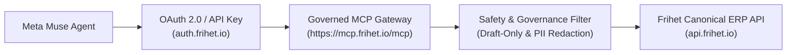

# Official Frihet Connector for Meta Muse

This directory contains the integration manifest, metadata, and submission contract for publishing **Frihet ERP** as an official connector and business application in **Meta Muse**.

Tracking issue: [berthelius/Frihet-ERP#2291](https://github.com/berthelius/Frihet-ERP/issues/2291).

---

## 1. Architectural Blueprint

The connector connects Meta Muse directly to Frihet's governed MCP/API gateway rather than creating a fragmented, product-specific backend:



### Complementary Channels
- **Official Connector (Direct / Branded):** Direct Meta Muse App integration via `https://mcp.frihet.io/mcp` using the curated 18-tool profile.
- **Zapier MCP Bridge (Broad Automation):** `Muse → Zapier MCP → Frihet Zapier App → Frihet`.

---

## 2. First-Release Curated Tool Surface (18 Tools)

Rather than exposing the complete 165-tool internal enterprise catalogue, the Muse connector exposes a curated, high-confidence surface designed for small-to-medium business management:

### A. Business Health & Financial Context (Read-Only)
- `frihet_get_business_context`: Overview of current business setup, currency, and operating summary.
- `get_monthly_summary`: Revenue, expenses, net margin, and cash summary for a specific calendar month.
- `get_quarterly_taxes`: Estimated quarterly VAT/IRPF obligations and fiscal calendar deadlines.

### B. Invoicing & Receivables (Read-Only + Draft Mutation)
- `list_invoices`: Search and list customer invoices (draft, sent, paid, overdue).
- `get_invoice`: Retrieve full line-item details of a specific invoice.
- `search_invoices`: Free-text search across client names, invoice references, and totals.
- `create_invoice`: **Draft-Only** creation. Agents cannot finalize invoices or report them to tax authorities without explicit human approval in the ERP UI.

### C. Expense Tracking & Vendors
- `list_expenses`: Paginated listing of expenses with date range and category filters.
- `get_expense`: Detailed view of a recorded expense and associated tax deductibility.
- `create_expense`: Draft expense registration for receipt review.

### D. Clients & CRM Context
- `list_clients`: List active clients and customer profiles.
- `get_client`: Retrieve client billing address, contact information, and payment terms.
- `create_client`: Register a new customer record.

### E. Product Catalog & Quotes
- `list_products`: Catalog items, standard pricing, and VAT classifications.
- `get_product`: Detailed SKU lookup.
- `list_quotes`: Commercial proposals and quotes.
- `get_quote`: Specific quote line items and status.
- `create_quote`: Draft commercial quote generation.

---

## 3. Governance & Safety Guarantees

1. **Draft-Only Invariant:** AI agents cannot finalize or legally issue invoices or file tax declarations (VeriFactu, TicketBAI, Facturae). All agent-generated financial documents enter as `draft`.
2. **PII Masking & Privacy:** Sensitive identifying information (NIF/CIF tax IDs, IBAN bank account numbers, physical addresses) is automatically redacted in conversational context.
3. **Idempotency:** All mutations accept an `Idempotency-Key` header ensuring duplicate assistant invocations do not produce double charges or duplicate draft records.
4. **Tamper-Evident Audit Trail:** Every tool execution records the caller identity (`agent:meta-muse`), timestamp, workspace ID, and parameters in Frihet's security event log.

---

## 4. Submission Manifest Contract

The formal metadata descriptor is located in [manifest.json](./manifest.json).

### Validation
To validate the manifest against standard schemas:
```bash
node -e '
const fs = require("fs");
const manifest = JSON.parse(fs.readFileSync("marketplace/muse/manifest.json", "utf8"));
if (!manifest.capabilities.tools || manifest.capabilities.tools.length !== 18) {
  throw new Error("Invalid tool count for curated Muse profile");
}
console.log("✅ Meta Muse manifest is valid with", manifest.capabilities.tools.length, "tools");
'
```
