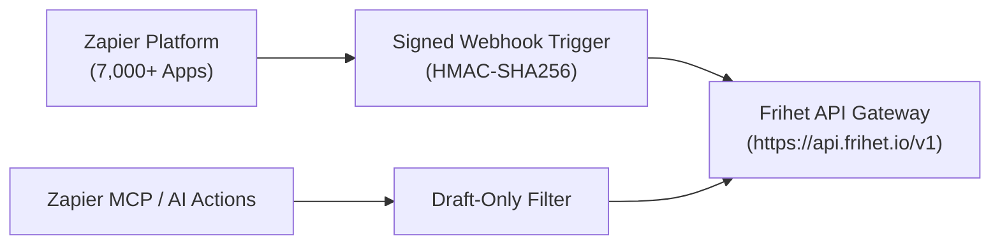

# Frihet ERP Integration for Zapier & Zapier MCP

This package provides the official integration definitions for connecting **Frihet ERP** to the [Zapier Platform](https://platform.zapier.com/) and the **Zapier MCP AI Actions** bridge.

Referenced in architecture contract: [berthelius/Frihet-ERP#2291](https://github.com/berthelius/Frihet-ERP/issues/2291).

---

## 1. Architecture



---

## 2. Triggers & Actions Provided

### Triggers (Instant Webhooks)
- `invoice.paid`: Emits when a customer pays an invoice via Stripe, bank transfer, or POS.
- `invoice.created`: Emits when an invoice is issued or drafted.
- `expense.created`: Emits when a receipt is captured or expense logged.

### Actions (Governed Creates)
- `create_draft_invoice`: Creates a new draft invoice with line items. Never auto-reports to tax authorities (VeriFactu / TicketBAI / FACe).
- `create_client`: Registers a customer profile and billing details.
- `get_business_summary`: Retrieves revenue, expense, and tax overview.

---

## 3. Zapier CLI Deployment

```bash
npm install -g zapier-platform-cli
zapier login
zapier validate
zapier push
```
