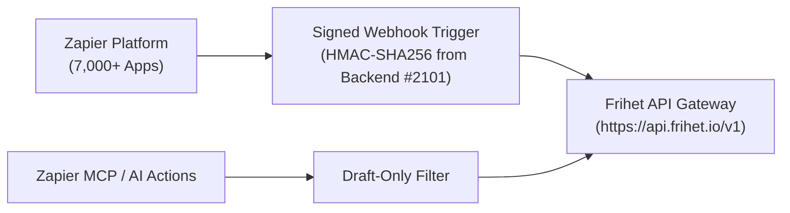

# Frihet ERP Integration Definition for Zapier & Zapier MCP

This package provides the declarative schema definitions (`definition.json`) for connecting **Frihet ERP** to the [Zapier Developer Platform](https://platform.zapier.com/) and the **Zapier MCP AI Actions** bridge.

> **Status:** Zapier Platform Schema & Action Definition (`CONTRACT_TESTED`).
> **Relationship to Backend Zapier Integration ([berthelius/Frihet-ERP#2101](https://github.com/berthelius/Frihet-ERP/issues/2101)):**
> Server-side webhook delivery and HMAC-SHA256 event signing are implemented in Frihet ERP backend services (`functions/src/webhooks/zapier.ts`). This package provides the complementary client-facing Zapier CLI schema declaring those triggers and governed draft actions for the Zapier partner portal.

---

## 1. Architecture



---

## 2. Triggers & Actions Declared

### Triggers (Instant Webhooks handled by backend)
- `invoice.paid`: Emitted when a customer pays an invoice via Stripe, bank transfer, or POS.
- `invoice.created`: Emitted when an invoice is issued or drafted.
- `expense.created`: Emitted when a receipt is captured or expense logged.

### Actions (Governed Creates via API)
- `create_draft_invoice`: Creates a new draft invoice with line items (`status: "draft"` enforced). Never auto-reports to European fiscal authorities (VeriFactu / TicketBAI / FACe).
- `create_client`: Registers a customer profile and billing details.
- `get_business_summary`: Retrieves revenue, expense, and tax overview.

---

## 3. Zapier CLI Platform Deployment

To validate and deploy this definition to the Zapier Developer Platform:

```bash
# Install Zapier Platform CLI
npm install -g zapier-platform-cli

# Authenticate with Zapier Developer account
zapier login

# Validate definition schema
zapier validate

# Push/update app in Zapier Developer portal
zapier push
```
